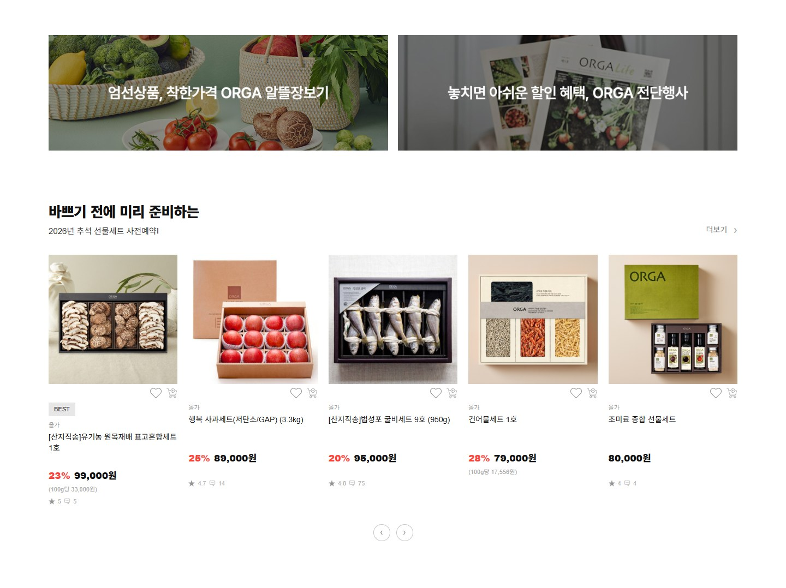
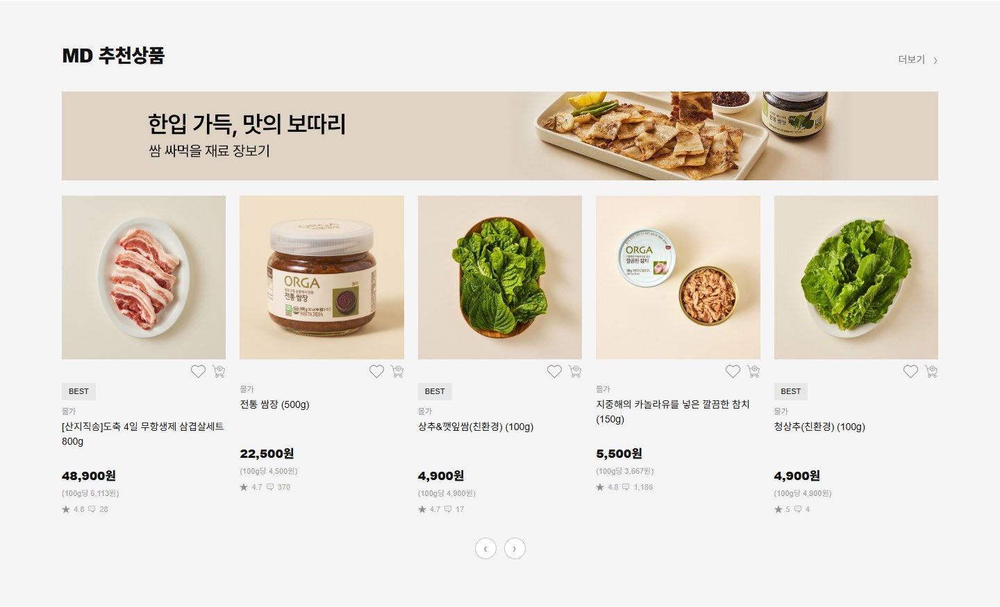
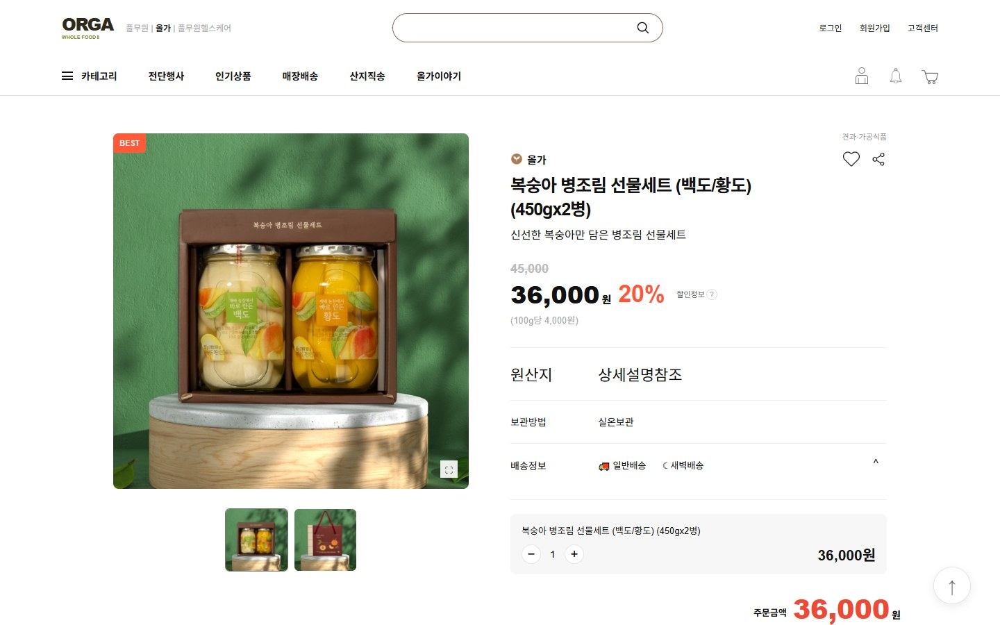
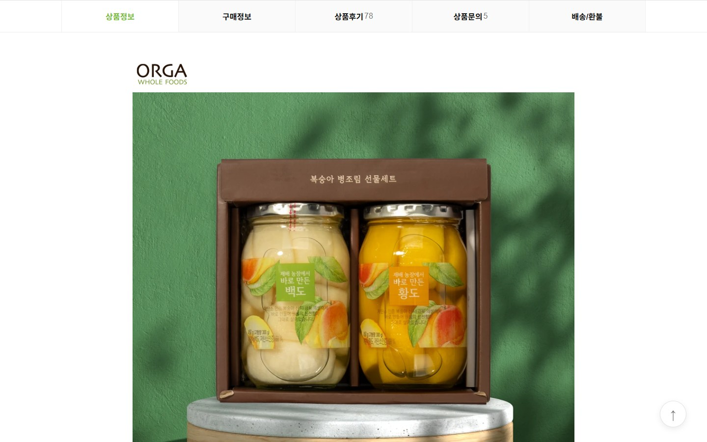
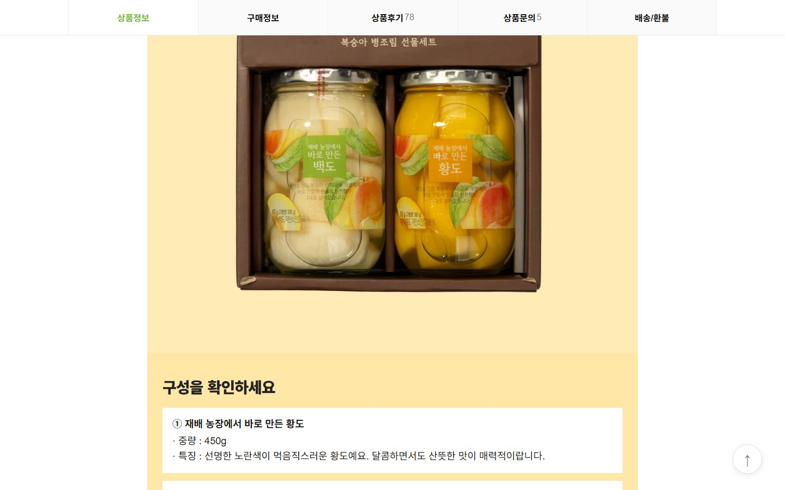

# 🥬 ORGA Whole Foods

**올가 홀푸드 쇼핑몰을 본뜬 반응형 웹사이트 — 데이터(JSON)와 화면을 분리해 만든 정적 사이트**

메인 페이지(헤더 · 배너 슬라이더 · 카테고리 · 상품 6개 섹션)와 상품 상세 페이지(이미지 확대 · 수량/금액 계산 · 배송정보 · 연관 상품 슬라이더 · 상세 콘텐츠)를 **HTML · CSS · 바닐라 JavaScript**만으로 구현했습니다. 상품 정보는 JSON 파일에서 불러와 그리고, 스타일은 `reset · common · main · sub`로 나눠 새 페이지를 추가하기 쉽게 설계했습니다.

링크: https://su4228-prog.github.io/0825_004/

<p align="center">
  
</p>
<p align="center"><sub>▶ 배포 사이트 기능 시연 (약 74초) · 메인 슬라이더 → 상품 섹션 → 상세 이동 → 이미지 확대 → 배송정보 · 수량 → 연관 상품 → 상세 콘텐츠 · 고화질 영상: <a href="./docs/readme/demo/demo.mp4">demo.mp4</a></sub></p>

[](https://su4228-prog.github.io/0825_004/)


> 📑 슬라이드(16:9)로 보기: 아래 [슬라이드 펼쳐보기](#-슬라이드-펼쳐보기)에서 18장을 이미지로 볼 수 있고, [`docs/readme/README.html`](./docs/readme/README.html)은 같은 슬라이드의 HTML 원본입니다. 이미지는 같은 폴더의 `img/`를 사용하므로 폴더째 내려받아 브라우저에서 열어 주세요.

| 페이지 | 상품 카드 | JSON 데이터 | 이미지 | 반응형 분기점 |
|:---:|:---:|:---:|:---:|:---:|
| **2개** | **33개** | **7개** | **108개** | **10단계** |

---

## 📌 목차

1. [개요](#-개요)
2. [설계 목표](#-설계-목표)
3. [기술 스택과 배포 구조](#-기술-스택과-배포-구조)
4. [주요 기능](#-주요-기능)
5. [JSON 기반 렌더링 구조](#-json-기반-렌더링-구조)
6. [CSS 구조와 반응형](#-css-구조와-반응형)
7. [기술적 의사결정](#-기술적-의사결정)
8. [프로젝트 구조와 데이터 모델](#-프로젝트-구조와-데이터-모델)
9. [실행 방법](#-실행-방법)
10. [검증 결과](#-검증-결과)
11. [회고와 향후 계획](#-회고와-향후-계획)
12. [슬라이드 펼쳐보기](#-슬라이드-펼쳐보기)

---

## 🗂 개요

| 항목 | 내용 |
|---|---|
| **목표** | 쇼핑몰 화면(메인 · 상품 상세)을 직접 구현하고, 데이터 · 스타일 · 스크립트를 역할별로 나눠 관리합니다. |
| **메인 페이지** | 헤더 · 배너 슬라이더 · 카테고리 12개 · 상품 6개 섹션(33개 카드) · 푸터 |
| **상세 페이지** | 이미지 확대 · 수량/금액 계산 · 배송정보 접기/펼치기 · 연관 상품 슬라이더 · 상세 콘텐츠 14블록 |
| **데이터** | `json/` 7개 파일 — 섹션별 상품 6종 + 상세 1종 |
| **스타일** | `reset` · `common` · `main` · `sub` CSS 4개 |
| **개발** | su4228-prog — 화면 구현 · 구조 설계 · 배포 |
| **실행 환경** | 배포 사이트 [su4228-prog.github.io/0825_004](https://su4228-prog.github.io/0825_004/) (GitHub Pages) · 로컬 `http://localhost:8080` |

> **저작권 안내** — 학습과 포트폴리오 목적으로 만든 프로젝트이며, 상호 · 로고 · 상품 이미지와 문구의 권리는 각 권리자에게 있습니다.

---

## 🎯 설계 목표

화면이 커져도 관리할 수 있도록 세 가지 기준을 먼저 정하고 구조를 잡았습니다.

| # | 기준 | 구현 | 결과 |
|:---:|---|---|---|
| 01 | **데이터와 화면의 분리** | 상품 이름 · 가격 · 이미지를 HTML에 직접 쓰지 않고 JSON으로 분리. `01~06_fetch_*.js`가 읽어서 카드를 생성하고, 없는 값(할인 · 평점 등)은 화면에서 자동 생략 | 상품이 바뀌면 JSON만 수정 · 카드 33개를 코드 6개 파일이 그림 |
| 02 | **공통과 페이지별 스타일 분리** | `reset.css`(초기화) · `common.css`(헤더 · 푸터 · 변수) · `main.css` / `sub.css`(페이지 전용) | 서브 페이지는 reset + common에 전용 CSS만 추가 |
| 03 | **페이지 사이를 잇는 구조** | 카드 이미지 36곳 → `sub.html` 링크, `sub.json` 한 파일로 상세 전체 렌더링, 상세 콘텐츠는 블록 타입별 템플릿으로 조립 | 상품별 상세로 확장할 수 있는 뼈대 |

---

## 🛠 기술 스택과 배포 구조

| 구분 | 기술 |
|---|---|
| **마크업** | HTML5 시맨틱 태그 (`header` · `main` · `section` · `article`) |
| **스타일** | CSS3 · 변수(`:root`) · Grid · Flex · `aspect-ratio` · 미디어쿼리 |
| **스크립트** | JavaScript (ES Modules `import / export`) |
| **데이터** | JSON 7개 · `fetch()` + 템플릿 문자열로 렌더링 |
| **인터랙션** | 배너 슬라이더(자동재생 · 일시정지) · 이미지 확대 렌즈 · 수량 계산 · 접이식 배송정보 · 연관 상품 슬라이더 |
| **배포** | GitHub Pages — 저장소 루트를 그대로 정적 호스팅 (빌드 단계 없음) |
| **서버** | 없음 (이번 버전). 백엔드는 [향후 계획](#-회고와-향후-계획) |

```text
브라우저 ──▶ GitHub Pages (정적 파일만 전달, 서버 코드 실행 없음)
              │  index.html · sub.html · css/ · js/ · json/ · img/
              ▼
          브라우저에서 실행되는 JS
              │  fetch("./json/…")  →  카드 HTML 생성  →  화면에 삽입
              └─ 상세: fetch("./json/sub.json") → 갤러리 · 가격 · 연관상품 · 상세 블록 렌더링
```

> ⚠️ **`fetch`를 쓰기 때문에** `index.html`을 더블클릭해서 열면(`file://`) JSON을 읽지 못해 상품이 비어 보입니다. 로컬에서도 HTTP 서버가 필요합니다. ([실행 방법](#-실행-방법))

---

## ✨ 주요 기능

### 1. 메인 — 헤더 · 배너 · 카테고리

첫 화면에서 브랜드 메뉴와 프로모션 배너, 12개 카테고리까지 한 번에 보여줍니다.

- **배너 슬라이더**: 8장 중 한 화면에 3장(모바일 1장) 노출 · 3.5초 자동 넘김 · 이전/다음 · 일시정지(Ⅱ ↔ ▶) · 현재 번호 카운터(`2 / 8`)
- **화면 크기 변화 대응**: 창 크기가 바뀌면 슬라이드 이동 거리를 다시 계산

<p align="center">
  
  
</p>

---

### 2. 상품 섹션 6개 — 33개 카드

섹션마다 배경색과 카드 구성을 달리하고, 가격 · 할인 · 평점 같은 요소는 **데이터가 있을 때만** 표시합니다.

| 섹션 | 카드 수 | 특징 |
|---|:---:|---|
| 고객 맞춤 추천 (#AI) | 5 | 할인 뱃지 · 단위 가격 · 평점/후기 |
| 올가 할인 특가 | 5 | 베이지 배경, 할인율을 빨간색으로 강조 |
| 광고 배너 + 추석 선물세트 | 5 | 배너 2개와 사전예약 카드 |
| MD 추천상품 | 5 | 와이드 배너 + 카드 그리드 |
| NEW 신상품 | 3 | 메인 이미지 + 썸네일 2단 레이아웃 |
| 베스트 상품 | 10 | 카테고리 탭과 1~10위 순위 번호 |

<p align="center">
  
  
</p>
<p align="center">
  
  
</p>
<p align="center">
  
  
</p>

---

### 3. 상품 상세 — 갤러리와 이미지 확대

카드 이미지를 누르면 `sub.html`로 이동합니다. 대표 이미지에 마우스를 올리면 **확대 렌즈(250px)** 가 따라다니며 오른쪽에 확대 결과(550px)를 보여줍니다.

- 대표 이미지 + 썸네일 전환 · BEST 뱃지 · 카테고리 · 브랜드
- 정가 취소선 · 판매가 · **할인율** · 100g당 단가 · 원산지/보관방법
- 찜하기 · 공유하기(주소 복사 또는 기기 공유) · 맨 위로 버튼

<p align="center">
  
  
</p>

---

### 4. 수량 계산 · 배송정보 · 연관 상품

| 기능 | 동작 |
|---|---|
| **수량 · 금액** | ＋ / － 버튼으로 수량을 바꾸면 판매가 × 수량이 주문금액과 항목 금액에 동시에 반영 (최소 1개) |
| **배송정보 토글** | 일반배송 · 새벽배송 도착 예정일과 배송비 기준을 `max-height` 전환으로 접고 펼침 |
| **연관 상품 슬라이더** | 연관 상품 10개를 화면 폭에 따라 5 → 3 → 2개씩 노출, 처음과 끝에서는 이전/다음 버튼 비활성 |

<p align="center">
  
  
</p>

---

### 5. 상세 콘텐츠 — 블록 14개로 조립

긴 상세 설명을 HTML로 쓰지 않고, **블록 타입과 내용만 JSON에 적으면** 화면이 만들어집니다.

| 블록 타입 | 용도 | 개수 |
|---|---|:---:|
| `image` | 이미지 블록 (로고 · 일반 · 좁은 폭) | 8 |
| `storyIntro` | 소개 문구 + 특징 4개 | 1 |
| `yellowPanel` | 구성 안내 박스 | 1 |
| `textSection` | 제목 + 문단 | 2 |
| `storage` | 보관법 안내 | 1 |
| `brandMessage` | 브랜드 메시지 이미지 | 1 |

<p align="center">
  
  
</p>

---

## 🧩 JSON 기반 렌더링 구조

섹션마다 JSON 파일과 렌더링 함수가 짝을 이루고, `main.js` 한 곳에서 모두 실행합니다.

```jsonc
// json/client_products.json (일부)
{
  "section_title": "고객님만을 위한 이 상품",
  "items": [{
    "id": 1,
    "image": "./img/client_product/01.jpg",
    "name": "블루베리가 들어간 샌드웨이퍼 (32g)",
    "price": "4,200원",
    "rating": 4.8, "reviews": 415
  }]
}
```

```js
// js/01_fetch_client.js (일부)
export function loadClientProducts() {
  fetch("./json/client_products.json")
    .then((res) => res.json())
    .then((data) => {
      grid.innerHTML = data.items.map((item) => {
        const badge = item.badge ? `<span …>` : "";   // 값이 있을 때만 태그 생성
        return `<article class="client-card"> … </article>`;
      }).join("");
    });
}
```

| JSON | 항목 수 | 렌더링 함수 | 화면 영역 |
|---|:---:|---|---|
| `client_products.json` | 5 | `loadClientProducts` | 고객 맞춤 추천 |
| `discount_products.json` | 5 | `loadDiscountProducts` | 올가 할인 특가 |
| `gift_products.json` | 5 | `loadGiftProducts` | 추석 선물세트 |
| `md_products.json` | 5 | `loadMdProducts` | MD 추천상품 |
| `new_products.json` | 3 | `loadNewProducts` | NEW 신상품 |
| `best_products.json` | 10 | `loadBestProducts` | 베스트 상품 |
| `sub.json` | — | `sub.js` 내부 렌더러 | 상세 페이지 전체 |

---

## 🎨 CSS 구조와 반응형

7개로 흩어져 있던 스타일을 역할 기준 4개로 정리하고, 반응형 규칙도 담당 파일 안에 두었습니다.

| 파일 | 줄 수 | 담당 영역 | 로드하는 페이지 |
|---|---:|---|---|
| `reset.css` | 42 | box-sizing · 여백 · 링크 · 버튼 · 이미지 초기화 | 전체 |
| `common.css` | 492 | 색상 변수 · `.wrap` · 원형 버튼 · **헤더 · 푸터** · 공통 반응형 | 전체 |
| `main.css` | 1,476 | 슬라이더 · 카테고리 · 상품 카드 공통 · 6개 섹션 · 반응형 | `index.html` |
| `sub.css` | 1,723 | 갤러리 · 확대 · 가격 · 배송 · 주문 · 연관 슬라이더 · 상세 블록 | `sub.html` |

로드 순서는 `reset → common → main(또는 sub)`로, 뒤쪽이 앞쪽을 덮어쓰도록 했습니다.

| 폭 | 달라지는 것 |
|---|---|
| ≤ 1100px | 헤더 2열 · 회원 메뉴 숨김 · 카테고리 6열 |
| ≤ 980px | 베스트 탭 가로 스크롤 · 베스트 2열 |
| ≤ 900px | 상품 그리드 5열 → 2열 · 푸터 1열 |
| ≤ 800px | 상세 1열 · 확대 기능 해제 |
| ≤ 760px | 헤더 1열 · 슬라이더 1장(미리보기) · 카테고리 4열 |
| ≤ 560px | 모든 상품 그리드 1열 |
| ≤ 520px | 상세 글자 크기 · 구매 버튼 1열 |

<p align="center">
  
  
  
</p>
<p align="center"><sub>390px 폭 — 메인 · 상품 카드 · 상세 (상세 페이지의 가로 넘침은 <a href="#-검증-결과">검증 결과</a> 참고)</sub></p>

---

## 💡 기술적 의사결정

| 항목 | 채택 | 검토 대안 | 이유 |
|---|---|---|---|
| **데이터 저장** | JSON 파일 + `fetch` | HTML에 직접 작성 / DB | 읽기 전용이고 갱신이 적어 DB는 과하고, HTML 직접 작성은 수정할 곳이 너무 많아집니다. |
| **렌더링 코드 분리** | 섹션별 `export function` | 하나의 큰 스크립트 | import되는 순간 실행되는 것을 막고, `main.js`에서 실행 시점을 한 곳에서 제어합니다. |
| **스타일 분리** | reset · common · main · sub | 섹션마다 CSS 파일 | 파일이 많아 관리가 어려웠고, 서브 페이지 추가를 고려해 “공통 / 페이지별”로 나눴습니다. |
| **상세 콘텐츠** | 블록 타입별 템플릿 | 상세 HTML 직접 작성 | 상품이 늘어도 같은 코드로 다른 내용을 그릴 수 있습니다. |
| **없는 값 처리** | 값이 있을 때만 태그 생성 | 빈 칸으로 표시 | 할인 · 평점이 없는 상품도 레이아웃이 깨지지 않습니다. |
| **페이지 이동** | `<a href target="_self">` | `onclick` 스크립트 이동 | 링크 형태를 유지해야 검색 · 키보드 이동 · 새 탭 열기가 기본으로 동작합니다. |
| **배포** | GitHub Pages | 별도 서버 호스팅 | 빌드 없이 저장소를 그대로 올릴 수 있어 포트폴리오 링크로 공유하기 쉽습니다. |

---

## 📂 프로젝트 구조와 데이터 모델

```text
0825_004/
├─ index.html            # 메인 페이지
├─ sub.html              # 상품 상세 페이지
├─ css/
│  ├─ reset.css          # 기본값 초기화
│  ├─ common.css         # 헤더 · 푸터 · 공통
│  ├─ main.css           # 메인 전용
│  └─ sub.css            # 상세 전용
├─ js/
│  ├─ main.js            # 모듈 실행 진입점
│  ├─ slider.js          # 배너 슬라이더
│  ├─ 01~06_fetch_*.js   # 섹션별 렌더링
│  └─ sub.js             # 상세 렌더링 · 인터랙션
├─ json/                 # 상품 데이터 7개
├─ img/                  # 섹션별 이미지 108개
├─ docs/readme/          # README 슬라이드 · 화면 · 시연 영상
└─ README.md
```

```jsonc
// 섹션 JSON 공통 구조 (요약)
{ "section_title": "…",
  "items": [{ "id", "brand", "badge", "image", "name",
              "discount", "price", "unit_price",
              "rating", "reviews", "delivery_badge" }] }

// sub.json 구조 (요약)
{ "product":       { "category", "brand", "badge", "nameLines", "price", "delivery", "gallery" },
  "aiRecommend":   [ /* 연관 상품 10개 */ ],
  "infoTabs":      [ /* 탭 5개 */ ],
  "detailContent": [ /* 상세 블록 14개 */ ] }
```

---

## 🚀 실행 방법

설치할 패키지는 없습니다(npm 불필요, 빌드 단계 없음). 파일을 내려받아 간단한 HTTP 서버로 열면 됩니다.

```powershell
git clone https://github.com/su4228-prog/0825_004.git
cd 0825_004

# Python이 있다면 (권장)
python -m http.server 8080
```

브라우저에서 `http://localhost:8080/` 을 엽니다. 상세 페이지는 `http://localhost:8080/sub.html` 입니다.

| 방법 | 명령 |
|---|---|
| **Python** | `python -m http.server 8080` |
| **Node.js** | `npx serve .` |
| **VS Code** | Live Server 확장 → `Go Live` |
| **설치 없이** | 배포 사이트 [su4228-prog.github.io/0825_004](https://su4228-prog.github.io/0825_004/) |

> `index.html`을 더블클릭해 열면(`file://`) 브라우저 보안 정책 때문에 JSON을 읽지 못합니다. 반드시 위 방법 중 하나로 실행하세요.

---

## ✅ 검증 결과

2026.10.17, **배포 사이트**를 브라우저 자동화(Playwright · Chrome)로 직접 열어 확인했습니다.

| 검사 | 결과 |
|---|---|
| 메인 상품 카드 수 | 33개 (추천 5 · 할인 5 · 선물 5 · MD 5 · 신상품 3 · 베스트 10) |
| 상세 페이지 연결 | 카드 이미지 36곳 모두 `href="sub.html" target="_self"` |
| 이미지 로드 | 메인 197개 · 상세 전부 정상 (깨진 이미지 0) |
| 오류 | JS 오류 0건 · HTTP 오류(404 등) 0건 |
| 슬라이더 | 배너 8장 · 다음 버튼 후 카운터 2 · 일시정지 전환 확인 |
| 상세 렌더링 | 썸네일 2 · 연관상품 10 · 탭 5 · 상세 블록 14 |
| 수량 계산 | 수량 3 → 108,000원 · 수량 2 → 72,000원 |
| 인터랙션 | 배송정보 펼침 · 찜 활성 · 썸네일 전환 정상 |
| 가로 넘침 | 1440 · 1100 · 900 · 760 · 560px에서 메인/상세 모두 0 · 메인은 390px도 0 |

### 🔧 개선 예정 항목

| 항목 | 내용 |
|---|---|
| **상세 페이지 390px 가로 보정** | 상세 페이지를 390px 폭에서 열면 가로로 **69px** 넘칩니다. 데스크톱 · 태블릿 폭에서는 정상이며, 모바일 상세의 고정 폭 요소가 원인으로 보입니다. 개선 예정입니다. |

**검증하지 않은 범위**: 모든 브라우저 · 기기 실측, 접근성 전수 점검, 이미지 사용 권한 검토.

---

## 📈 회고와 향후 계획

**잘한 점 (Keep)**
- **데이터와 화면을 분리**해 상품 정보를 JSON만 고쳐 바꿀 수 있습니다.
- **공통 / 페이지별 CSS**로 나눠 새 페이지를 추가하기 쉬워졌습니다.
- 상세 설명을 **블록 구조**로 만들어 같은 코드로 다른 내용을 그릴 수 있습니다.
- 없는 값은 자동으로 생략해 레이아웃이 깨지지 않습니다.
- 배포 사이트를 자동화 테스트로 직접 점검해 수치로 확인했습니다.

**개선할 점 (Improve)**
- 상세 페이지를 **상품 번호별로 연결** — 지금은 모든 카드가 상품 1개분의 상세 데이터(복숭아 병조림)로 이동합니다.
- 로그인 · 장바구니 · 검색 · 챗봇은 화면 구성까지 완료했고, **동작 기능은 다음 단계**에서 구현합니다.
- 가격을 `"4,200원"` 문자열에서 **숫자 값으로 전환**해 계산 · 정렬에 쓸 수 있게 합니다.
- 모바일(390px) 상세 페이지의 **가로 넘침 69px 보정**

**추후 단계 (Next) — 백엔드로 확장**

지금의 JSON 구조를 그대로 DB로 옮기고, 화면은 거의 바꾸지 않는 방향으로 진행할 계획입니다.

```text
브라우저 (현재 사이트)
   │  fetch("/api/...")
   ▼
FastAPI 서버 ──▶ Supabase (PostgreSQL)
   │              products · sections · section_products · product_details
   └────────────▶ OpenAI (챗봇, 버튼을 눌렀을 때만)
```

1. Supabase에 표 4개를 만들고 기존 JSON 이전 (같은 상품은 1줄로 합치고 섹션과는 연결 표로 묶기)
2. 섹션별 목록 · 상세 · 검색 API
3. 화면이 JSON 대신 API를 읽도록 변경 → 카드마다 자기 상세 페이지로 이동 (`sub.html?id=…`)
4. 쇼핑몰 안내 챗봇 (문서에 없는 내용은 “확인되지 않습니다”로 답변)
5. 서버 배포 · 챗봇 사용 횟수 제한 · 키는 서버에만 보관
6. 이후 회원가입 · 로그인 · 장바구니, 모바일 상세 넘침 수정

> 위 내용은 **계획**이며 현재 배포 사이트에는 서버가 없습니다.

---

## 📊 슬라이드 펼쳐보기

프로젝트 전체 내용을 16:9 슬라이드 18장으로 정리했습니다. 원본은 [`docs/readme/README.html`](./docs/readme/README.html)이며, 아래 이미지는 같은 슬라이드를 1600×900으로 내보낸 것입니다.

<details open>
<summary><b>📂 슬라이드 펼쳐보기 (총 18장)</b></summary>
<br />

<p align="center">
  <br /><sub>01 · 표지</sub><br /><br />
  <br /><sub>02 · 프로젝트 한눈에 보기</sub><br /><br />
  <br /><sub>03 · 설계 목표</sub><br /><br />
  <br /><sub>04 · 기술 스택과 배포 구조</sub><br /><br />
  <br /><sub>05 · 메인 화면 — 헤더 · 배너 · 카테고리</sub><br /><br />
  <br /><sub>06 · 상품 섹션 6개 — 33개 카드</sub><br /><br />
  <br /><sub>07 · JSON → 카드 렌더링 구조</sub><br /><br />
  <br /><sub>08 · 상품 상세 — 갤러리와 이미지 확대</sub><br /><br />
  <br /><sub>09 · 수량 계산 · 배송정보 · 연관 상품</sub><br /><br />
  <br /><sub>10 · 상세 설명은 “블록” 14개로 조립</sub><br /><br />
  <br /><sub>11 · CSS 구조 — 초기화 · 공통 · 페이지별</sub><br /><br />
  <br /><sub>12 · 반응형 — 데스크톱에서 모바일까지</sub><br /><br />
  <br /><sub>13 · 기술적 의사결정</sub><br /><br />
  <br /><sub>14 · 프로젝트 구조와 데이터 모델</sub><br /><br />
  <br /><sub>15 · 실행 방법</sub><br /><br />
  <br /><sub>16 · 검증 결과 — 배포 사이트 기준</sub><br /><br />
  <br /><sub>17 · 회고</sub><br /><br />
  <br /><sub>18 · 향후 계획 — 백엔드로 확장</sub><br /><br />
</p>

</details>

---

<sub>ORGA Whole Foods · su4228-prog · 검증 기준일 2026.10.17</sub>
