# 🥬 ORGA Whole Foods

**올가 홀푸드 쇼핑몰을 본뜬 반응형 웹사이트 — 화면(HTML · CSS · JS) + 상품 API 서버(FastAPI · Supabase) + 쇼핑몰 상담봇(OpenAI)**

1차로 메인 페이지와 상품 상세 페이지를 **HTML · CSS · 바닐라 JavaScript**로 만들고 상품 정보를 JSON으로 분리했습니다. 2차로 그 JSON을 **Supabase DB**로 옮기고 **FastAPI 서버**를 붙여, 카드마다 자기 상품의 상세 페이지(30개)로 이동하고 왼쪽 아래 **로봇 상담봇**이 배송 · 반품 · 적립금 · 상품 가격을 답하도록 확장했습니다.

🔗 **배포 사이트 바로가기 →** [https://orga-whole-food.onrender.com](https://orga-whole-food.onrender.com) <sub>(Render · 화면 + FastAPI + Supabase + 상담봇)</sub><br>

<p align="center">
  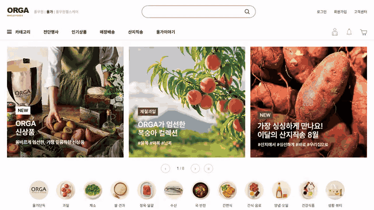
</p>
<p align="center"><sub>▶ 1차 버전 기능 시연 (약 74초) · 메인 슬라이더 → 상품 섹션 → 상세 이동 → 이미지 확대 → 배송정보 · 수량 → 연관 상품 → 상세 콘텐츠 · 고화질 영상: <a href="./docs/readme/demo/demo.mp4">demo.mp4</a></sub></p>

[](https://orga-whole-food.onrender.com)


> 📑 슬라이드(16:9)로 보기: 아래 [슬라이드 펼쳐보기](#-슬라이드-펼쳐보기)에서 18장을 이미지로 볼 수 있습니다. 슬라이드는 **1차(정적 사이트) 버전** 기준이며, 2차(서버 · 상담봇) 내용은 이 README에 정리했습니다.

| 페이지 | 상품 | 상세 페이지 | API | 상담봇 점검 | 반응형 분기점 |
|:---:|:---:|:---:|:---:|:---:|:---:|
| **2개** | **30개** (카드 33) | **30개** | **7개** | **22문항 통과** | **10단계** |

---

## 📌 목차

1. [개요](#-개요)
2. [설계 목표](#-설계-목표)
3. [기술 스택과 배포 구조](#-기술-스택과-배포-구조)
4. [주요 기능](#-주요-기능)
5. [백엔드 — 상품 API](#-백엔드--상품-api)
6. [상담봇](#-상담봇)
7. [CSS 구조와 반응형](#-css-구조와-반응형)
8. [기술적 의사결정](#-기술적-의사결정)
9. [프로젝트 구조와 데이터 모델](#-프로젝트-구조와-데이터-모델)
10. [실행 방법](#-실행-방법)
11. [검증 결과](#-검증-결과)
12. [회고와 향후 계획](#-회고와-향후-계획)
13. [슬라이드 펼쳐보기](#-슬라이드-펼쳐보기)

---

## 🗂 개요

| 항목 | 내용 |
|---|---|
| **목표** | 쇼핑몰 화면(메인 · 상품 상세)을 직접 구현하고, 데이터를 DB와 API 서버로 옮겨 실제 쇼핑몰처럼 동작하게 만듭니다. |
| **메인 페이지** | 헤더 · 배너 슬라이더 · 카테고리 12개 · 상품 6개 섹션(33개 카드) · 푸터 |
| **상세 페이지** | 상품 30개 각각의 상세 (`sub.html?id=번호`) · 이미지 확대 · 수량/금액 계산 · 배송정보 · 연관 상품 · 상세 콘텐츠 |
| **서버** | FastAPI — 섹션 · 상품 검색 · 상세 · 상담봇 API, 사이트 화면도 함께 제공 |
| **DB** | Supabase(PostgreSQL) — 상품 · 섹션 · 섹션-상품 연결 · 상세 4개 표 |
| **상담봇** | 쇼핑몰 이용 안내 + 상품 목록을 근거로 답하는 로봇 상담봇 (OpenAI `gpt-4o-mini`) |
| **개발** | su4228-prog — 화면 구현 · 구조 설계 · 서버 · 배포 |
| **실행 환경** | 배포 서버: [Render](https://orga-whole-food.onrender.com) · 로컬 서버: `http://127.0.0.1:8000` · 정적 버전: [GitHub Pages](https://su4228-prog.github.io/0825_004/) |

> **저작권 안내** — 학습과 포트폴리오 목적으로 만든 프로젝트이며, 상호 · 로고 · 상품 이미지와 문구의 권리는 각 권리자에게 있습니다. 상담봇의 이용 안내 문서는 실제 쇼핑몰 FAQ를 참고해 직접 다시 쓴 내용입니다.

---

## 🎯 설계 목표

| # | 기준 | 구현 | 결과 |
|:---:|---|---|---|
| 01 | **데이터와 화면의 분리** | 상품 정보를 HTML에 쓰지 않고 JSON → DB로 분리. `01~06_fetch_*.js`가 읽어서 카드를 생성하고, 없는 값(할인 · 평점 등)은 자동 생략 | 상품이 바뀌면 DB만 수정 · 카드 33개를 코드 6개 파일이 그림 |
| 02 | **서버가 없어도 동작** | 화면은 먼저 API를 부르고, 서버가 없거나 응답이 없으면 기존 `json/` 파일로 대신 | GitHub Pages(정적)와 서버 버전이 같은 코드로 동작 |
| 03 | **공통과 페이지별 스타일 분리** | `reset` · `common` · `main` / `sub` + 상담봇 전용 `chat.css` | 새 페이지 · 새 기능을 기존 화면에 영향 없이 추가 |
| 04 | **비밀 키는 서버에만** | OpenAI · Supabase 키는 `backend/.env`에만 두고 화면 코드에는 넣지 않음 | 브라우저에서 키가 보이지 않음 · `.env`는 GitHub에 올라가지 않음 |

---

## 🛠 기술 스택과 배포 구조

| 구분 | 기술 |
|---|---|
| **마크업 · 스타일** | HTML5 시맨틱 태그 · CSS3 변수 · Grid · Flex · `aspect-ratio` · 미디어쿼리 |
| **스크립트** | JavaScript (ES Modules) · `fetch()` + 템플릿 문자열 렌더링 |
| **서버** | Python · FastAPI · Uvicorn · Pydantic (입력 · 응답 형태 검사) |
| **DB** | Supabase (PostgreSQL) · 읽기 전용 보안 정책(RLS) |
| **상담봇** | OpenAI `gpt-4o-mini` · 이용 안내 문서 + 상품 목록 + 서버가 계산한 사실을 함께 전달 |
| **배포** | 정적 화면: GitHub Pages · 통합 서비스: Render 무료 Web Service (`main` 자동 배포, `/health` 상태 확인) |

```text
브라우저 ──▶ FastAPI 서버 (사이트 화면 + API를 한 주소에서 제공)
   │           ├─ /api/sections · /api/products ──▶ Supabase (상품 30 · 섹션 6 · 상세 30)
   │           └─ /api/chat ─(횟수 제한 통과 시)──▶ OpenAI
   │
   └─ 서버가 없을 때(GitHub Pages) ──▶ json/ 파일로 대신 표시 · 상담봇 버튼은 숨김
```

> ⚠️ `index.html`을 더블클릭해서 열면(`file://`) 데이터를 읽지 못해 상품이 비어 보입니다. 서버를 켜거나 HTTP 서버로 열어 주세요. ([실행 방법](#-실행-방법))

---

## ✨ 주요 기능

### 1. 메인 — 헤더 · 배너 · 카테고리

- **배너 슬라이더**: 8장 중 한 화면에 3장(모바일 1장) · 3.5초 자동 넘김 · 이전/다음 · 일시정지 · 현재 번호(`2 / 8`)
- 배너 · 카테고리 · 광고 배너는 보여주기용이라 다른 곳으로 이동하지 않고, **상품 카드만** 상세로 연결됩니다.

<p align="center">
  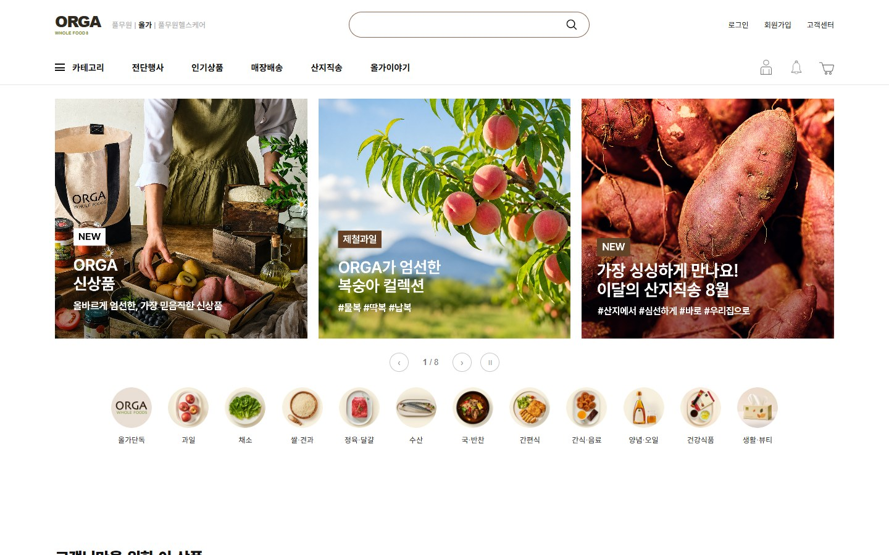
  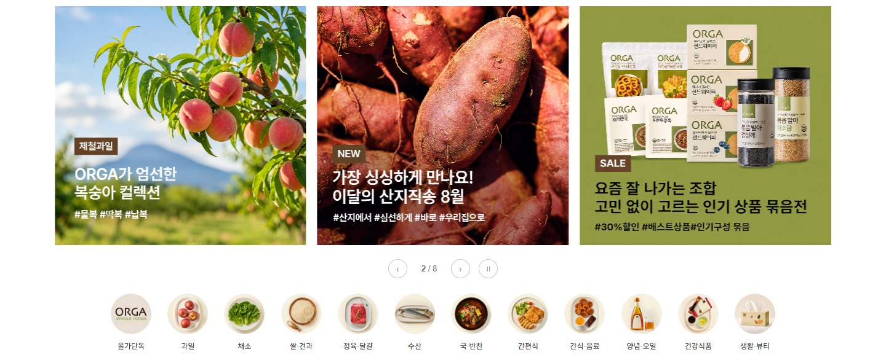
</p>

---

### 2. 상품 섹션 6개 — 33개 카드

섹션마다 배경색과 카드 구성을 달리하고, 가격 · 할인 · 평점은 **데이터가 있을 때만** 표시합니다. 같은 상품이 여러 섹션에 나오면 DB에서는 1개로 저장하고 섹션과 연결만 합니다(카드 33개 → 상품 30개).

| 섹션 | 카드 수 | 특징 |
|---|:---:|---|
| 고객 맞춤 추천 (#AI) | 5 | 할인 뱃지 · 단위 가격 · 평점/후기 |
| 올가 할인 특가 | 5 | 베이지 배경, 할인율 강조 |
| 광고 배너 + 추석 선물세트 | 5 | 배너 2개와 사전예약 카드 |
| MD 추천상품 | 5 | 와이드 배너 + 카드 그리드 |
| NEW 신상품 | 3 | 메인 이미지 + 썸네일 2단 레이아웃 |
| 베스트 상품 | 10 | 카테고리 탭과 1~10위 순위 번호 |

<p align="center">
  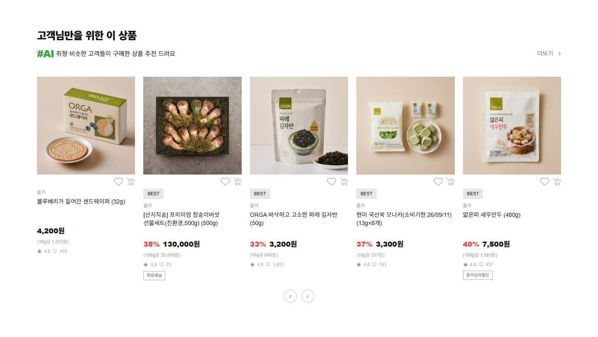
  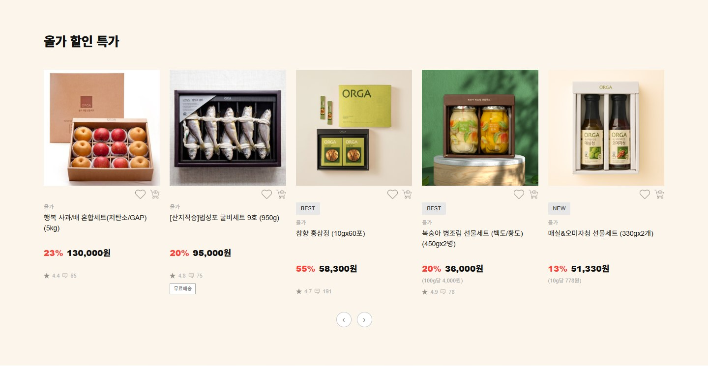
</p>
<p align="center">
  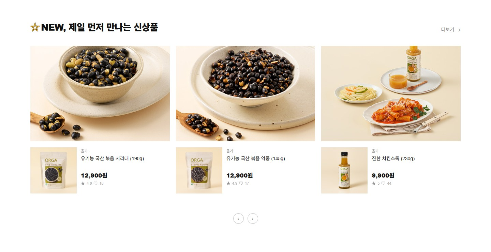
  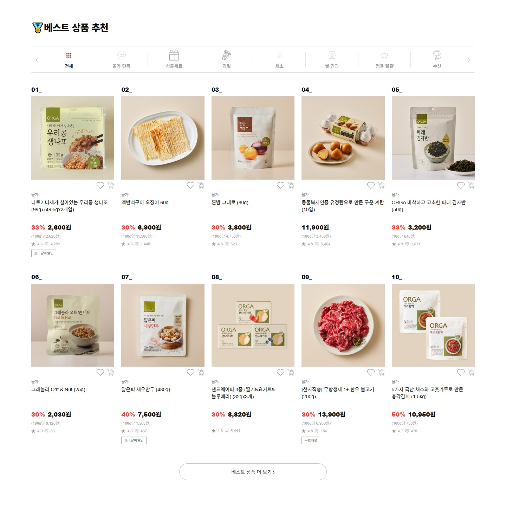
</p>

---

### 3. 상품 상세 — 30개 상품 각자의 페이지

카드를 누르면 `sub.html?id=번호`로 이동해 **그 상품의** 이름 · 가격 · 할인율 · 보관방법 · 상세 설명 · 연관 상품을 보여줍니다.

- 대표 이미지 + 썸네일 · **확대 렌즈(250px)** · 정가 취소선 · 할인율 · 단위 가격
- 수량 ＋/－ 로 주문금액 계산 · 배송정보 접기/펼치기 · 연관 상품 10개 슬라이더(같은 섹션 상품 우선)
- 상세 콘텐츠는 **블록 타입별 템플릿**으로 조립 — 복숭아 병조림은 원본 상세 14블록, 나머지 29개는 상품별 소개 · 특징 · 즐기는 법 · 보관법 문구로 구성
- 없는 상품 번호로 들어오면 “찾으시는 상품이 없습니다” 안내

<p align="center">
  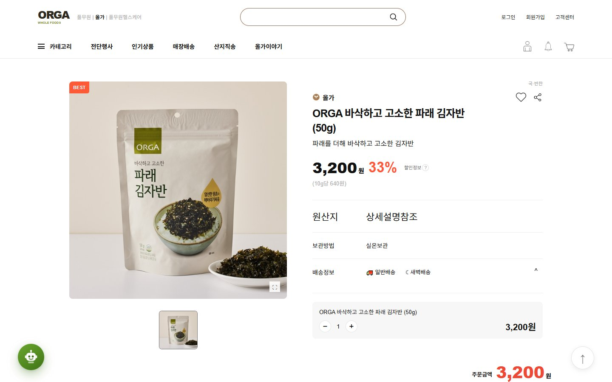
  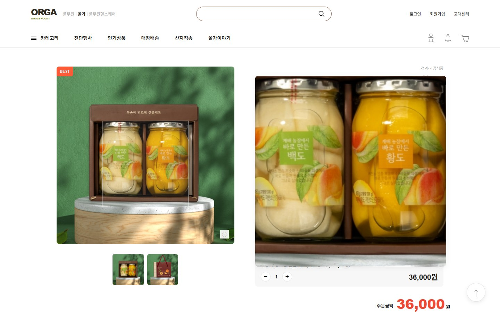
</p>
<p align="center">
  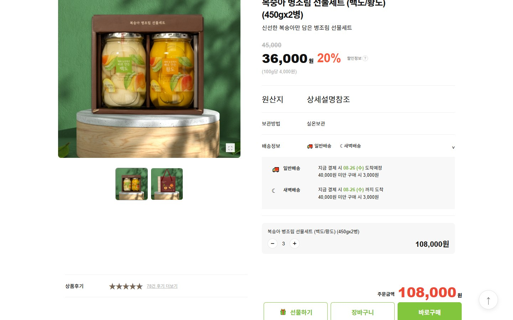
  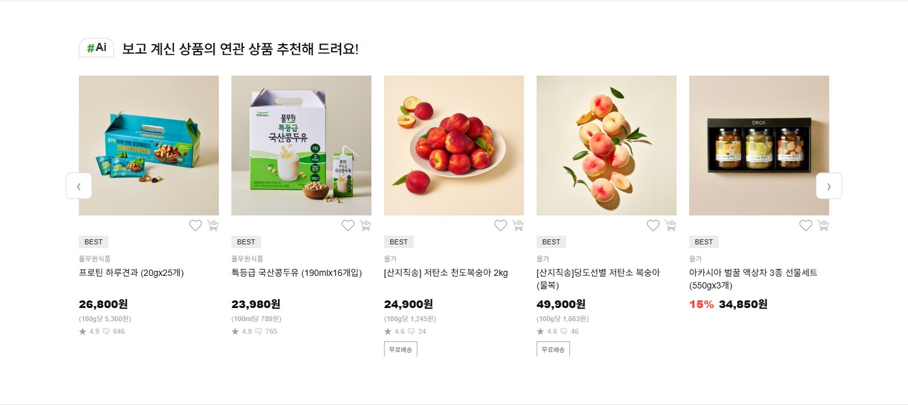
</p>

---

### 4. 상담봇 — 왼쪽 아래 로봇 버튼

모든 페이지 **왼쪽 아래**에 로봇 버튼이 떠 있고, 스크롤해도 같은 자리에 고정됩니다. 누르면 채팅 창이 살짝 떠오르며 열립니다. ([자세히](#-상담봇))

- 인사말 + 추천 질문 4개 · 답변 준비 중 점 3개 · 이전 대화를 이어서 질문 가능(“그거 2개 사면 얼마예요?”)
- 모바일에서는 아래에서 올라오는 전체 화면 창 · `Esc`로 닫기
- 서버가 없는 환경(GitHub Pages)에서는 버튼을 띄우지 않음

<p align="center">
  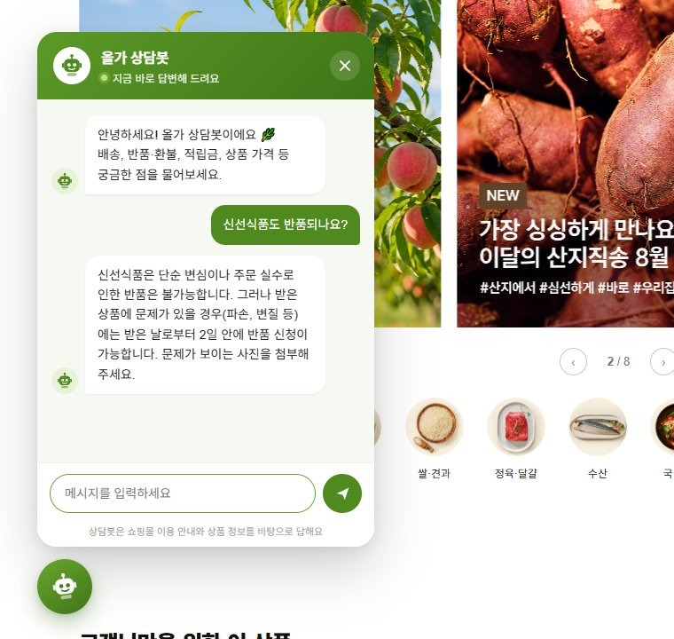
</p>

---

## 🔌 백엔드 — 상품 API

FastAPI가 Supabase에서 데이터를 읽어 화면이 쓰던 JSON과 **같은 모양**으로 돌려줍니다. 그래서 화면 코드는 데이터를 어디서 받는지만 바꾸고 그리는 부분은 거의 그대로입니다.

| 주소 | 하는 일 |
|---|---|
| `GET /api/sections` | 섹션 6개 목록 |
| `GET /api/sections/{key}` | 섹션 1개의 제목과 카드 목록 (`client` · `discount` · `gift` · `md` · `new` · `best`) |
| `GET /api/products?q=` | 상품 이름 · 브랜드 검색 |
| `GET /api/products/{id}` | 상품 상세 (상세 · 탭 · 연관 상품 포함) |
| `GET /api/chat/status` | 상담봇 사용 가능 여부 (화면의 버튼 표시 판단) |
| `POST /api/chat` | 상담봇 질문 |
| `GET /health` | 서버 상태 확인 |

`/docs`에서 모든 API를 직접 눌러 시험할 수 있습니다.

**DB 표 4개**

| 표 | 행 | 내용 |
|---|:---:|---|
| `products` | 30 | 이름 · 브랜드 · 가격(숫자) · 할인율 · 이미지 · 평점 등 |
| `sections` | 6 | 섹션 키 · 제목 · 순서 |
| `section_products` | 33 | 어느 섹션에 어떤 상품이 몇 번째로 나오는지 |
| `product_details` | 30 | 상세 페이지 내용 (JSON) |

- 가격을 `"4,200원"` 문자열에서 **숫자**로 바꿔 저장하고, 화면에 줄 때 다시 `4,200원`으로 만듭니다.
- 정가는 판매가와 할인율로 역산하되, **10원 단위로 정확히 맞을 때만** 표시합니다.
- 같은 사진이 중복된 상품은 사진 내용(md5)을 비교해 한 장만 씁니다.

---

## 🤖 상담봇

| 항목 | 내용 |
|---|---|
| **답하는 근거** | ① 쇼핑몰 이용 안내 문서(배송 · 주문취소 · 반품 · 환불 · 적립금 · 쿠폰 · 결제 · 고객센터) ② 상품 30개 목록 ③ 서버가 미리 계산한 사실(무료배송 상품, 베스트 순위, 질문 속 상품의 가격 · 보관방법 · 반품 기준) |
| **모르는 내용** | 문서에 없으면 지어내지 않고 “확인되지 않는다”고 안내 후 고객센터 연결 |
| **비용 · 남용 방지** | 한 사람당 10분에 10번 · 사이트 전체 하루 300번 · 질문 300자 · 이전 대화 6개까지만 전송 |
| **안전** | OpenAI 키는 서버에만 · 답변은 글자로만 화면에 넣어 HTML이 실행되지 않음 · 서버 오류 시 내부 정보 없이 짧은 안내만 표시 |

**정확도를 높인 방법** — 처음에는 모델이 베스트 순위나 무료배송 상품을 틀리게 말하는 경우가 있었습니다. 그래서 순위 · 무료배송 목록 · “냉장 상품은 2일, 상온 상품은 30일” 같은 반품 기준을 **서버가 먼저 계산해 함께 넘기도록** 바꿨고, 질문 22개 점검을 3번 연속 모두 통과했습니다.

---

## 🎨 CSS 구조와 반응형

| 파일 | 줄 수 | 담당 영역 | 로드하는 페이지 |
|---|---:|---|---|
| `reset.css` | 42 | box-sizing · 여백 · 링크 · 버튼 · 이미지 초기화 | 전체 |
| `common.css` | 492 | 색상 변수 · `.wrap` · 원형 버튼 · **헤더 · 푸터** · 공통 반응형 | 전체 |
| `main.css` | 1,476 | 슬라이더 · 카테고리 · 상품 카드 · 6개 섹션 | `index.html` |
| `sub.css` | 1,733 | 갤러리 · 확대 · 가격 · 배송 · 주문 · 연관 슬라이더 · 상세 블록 | `sub.html` |
| `chat.css` | 116 | 상담봇 버튼 · 채팅 창 | `chat.js`가 직접 불러옴 |

상담봇 스타일은 `chat.js`가 **CSS를 다 불러온 뒤에만** 버튼을 만들어서, 브라우저에 예전 CSS가 남아 있어도 스타일 없는 큰 아이콘이 보이지 않습니다.

| 폭 | 달라지는 것 |
|---|---|
| ≤ 1100px | 헤더 2열 · 회원 메뉴 숨김 · 카테고리 6열 |
| ≤ 980px | 베스트 탭 가로 스크롤 · 베스트 2열 |
| ≤ 900px | 상품 그리드 5열 → 2열 · 푸터 1열 |
| ≤ 800px | 상세 1열 · 확대 기능 해제 |
| ≤ 760px | 헤더 1열 · 슬라이더 1장(미리보기) · 카테고리 4열 |
| ≤ 560px | 상품 그리드 1열 · 상담봇 전체 화면 창 |
| ≤ 520px | 상세 글자 크기 · 구매 버튼 1열 |

<p align="center">
  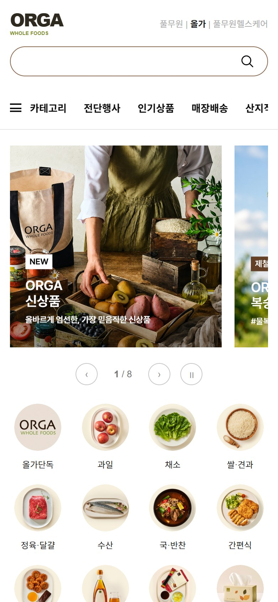
  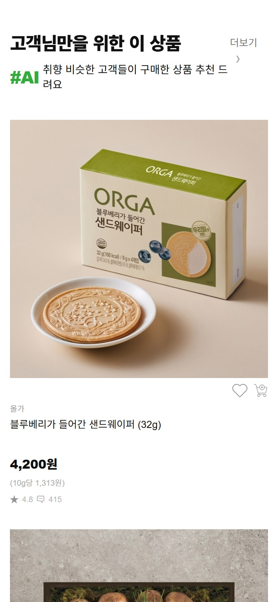
  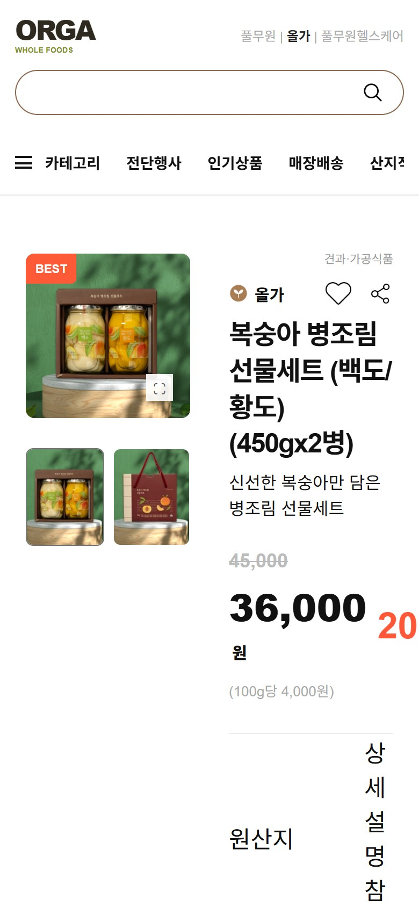
</p>

---

## 💡 기술적 의사결정

| 항목 | 채택 | 검토 대안 | 이유 |
|---|---|---|---|
| **데이터 저장** | Supabase (PostgreSQL) | JSON 파일 유지 | 상품별 상세 30개 · 검색 · 상담봇이 같은 데이터를 써야 해서 DB로 옮겼습니다. |
| **표 구조** | 상품 1개 = 1줄 + 섹션 연결 표 | 섹션마다 상품 복사 | 여러 섹션에 나오는 상품도 가격을 한 곳에서만 고치면 됩니다. |
| **서버** | FastAPI | Node(Express) | 입력 · 응답 형태 검사와 `/docs` 자동 문서가 기본으로 제공됩니다. |
| **API 응답 모양** | 기존 JSON과 같은 모양 | 새 형태로 설계 | 화면 렌더링 코드를 거의 바꾸지 않고 연결했습니다. |
| **서버 없을 때** | `json/` 파일로 대신 | 오류 화면 | GitHub Pages에서도 사이트가 그대로 보입니다. |
| **상담봇 근거** | 문서 + 상품 목록 + 서버 계산 사실 | 모델 지식만 사용 | 순위 · 가격 · 반품 기준처럼 틀리면 안 되는 내용을 정확하게 답합니다. |
| **상담봇 비용** | 횟수 제한 + 짧은 답변 + 작은 모델 | 제한 없음 | 공개 사이트에서 요금이 갑자기 늘지 않도록 막습니다. |
| **배포** | 서버 하나가 화면 + API 제공 (Render) | 화면 · 서버 따로 배포 | 주소 하나로 모든 기능이 동작하고 설정이 단순합니다. |

---

## 📂 프로젝트 구조와 데이터 모델

```text
orga_whole_food/
├─ index.html · sub.html     # 메인 · 상품 상세
├─ css/                      # reset · common · main · sub · chat
├─ js/
│  ├─ main.js · slider.js    # 실행 진입점 · 배너 슬라이더
│  ├─ api.js                 # 서버 주소 결정 · 서버 없으면 json 으로 대신
│  ├─ 01~06_fetch_*.js       # 섹션별 카드 렌더링
│  ├─ sub.js                 # 상세 렌더링 · 인터랙션
│  └─ chat.js                # 상담봇 버튼 · 채팅 창
├─ json/                     # 서버가 없을 때 쓰는 예비 데이터 7개
├─ img/                      # 상품 · 배너 이미지 108개
├─ requirements.txt          # 저장소 최상위에서 backend 의존성 설치
├─ backend/                  # 서버 (처음 켜는 방법: backend/README.md)
│  ├─ app.py                 # API 주소 · 사이트 화면 제공
│  ├─ services/              # 상품 · 상담봇 · 횟수 제한
│  ├─ rag_docs/policy.md     # 상담봇이 참고하는 이용 안내
│  ├─ sql/                   # Supabase 표 만들기
│  └─ scripts/               # 데이터 넣기 · 점검 도구
├─ render.yaml               # Render 배포 설정
└─ docs/readme/              # README 슬라이드 · 화면 · 시연 영상
```

```jsonc
// GET /api/products/3 (요약)
{ "id": 3, "hasFullDetail": false,
  "product":       { "category", "brand", "badge", "nameLines", "description", "price", "infoRows", "delivery", "gallery" },
  "aiRecommend":   [ /* 연관 상품 10개 (id 포함) */ ],
  "infoTabs":      [ /* 탭 5개 */ ],
  "detailContent": [ /* 상세 블록 */ ] }
```

---

## 🚀 실행 방법

### 서버 버전 (상품별 상세 + 상담봇)

```powershell
git clone https://github.com/su4228-prog/orga_whole_food.git
cd orga_whole_food\backend
python -m venv .venv
.venv\Scripts\python -m pip install -r requirements.txt
copy .env.example .env          # 메모장으로 열어 Supabase · OpenAI 키 입력
.venv\Scripts\python -m uvicorn app:app --host 127.0.0.1 --port 8000
```

브라우저에서 `http://127.0.0.1:8000/` 을 엽니다. DB 준비와 점검 도구는 [`backend/README.md`](./backend/README.md)에 정리했습니다.

### 정적 버전 (설치 없이 화면만)

```powershell
python -m http.server 8080
```

`http://localhost:8080/` 을 열면 `json/` 데이터로 화면이 보입니다(상세는 모두 복숭아 병조림, 상담봇 없음).

### Render 배포

무료 Web Service로 배포되어 사이트 · API · 상담봇이 한 주소에서 동작합니다.

- **사이트**: [https://orga-whole-food.onrender.com](https://orga-whole-food.onrender.com)
- **서버 상태**: [/health](https://orga-whole-food.onrender.com/health)
- **API 문서**: [/docs](https://orga-whole-food.onrender.com/docs)
- **Build Command**: `pip install -r backend/requirements.txt`
- **Start Command**: `cd backend && uvicorn app:app --host 0.0.0.0 --port $PORT`
- **Health Check Path**: `/health`

`SUPABASE_URL` · `SUPABASE_SERVICE_ROLE_KEY` · `OPENAI_API_KEY`는 저장소에 넣지 않고 Render 환경 변수로 관리합니다. `render.yaml`에는 같은 배포 구성을 다시 만들 수 있는 Blueprint 설정이 들어 있습니다.

---

## ✅ 검증 결과

2026.10.20, 서버 버전을 브라우저 자동화(Playwright · Chrome)와 점검 스크립트로 확인했습니다.

| 검사 | 결과 |
|---|---|
| 메인 | 카드 33개 · 상품 카드 이미지 36곳이 각자 `sub.html?id=번호`로 연결 · 배너/카테고리/광고는 링크 없음 · 깨진 이미지 0 |
| 상세 30개 | 모두 이름 · 상세 블록 · 연관 상품 10개 · 이미지 정상 · 없는 번호는 안내 문구 |
| 오류 | JS 오류 0건 · HTTP 오류 0건 |
| DB | 원본 JSON과 DB 데이터 일치 (`verify_seed.py`) |
| API | 섹션 · 검색 · 상세 · 잘못된 입력 처리 모두 통과 (`verify_api.py`) |
| 상담봇 | 질문 22개(배송 · 반품 · 적립금 · 가격 · 순위 · 모르는 질문 등) 3회 연속 전부 통과 (`test_chat.py`) |
| 상담봇 화면 | 왼쪽 아래 고정 · 스크롤해도 같은 자리 · 모바일 전체 화면 · 맨 위로 버튼과 겹치지 않음 |
| 서버 없는 환경 | 상품 33개 정상 표시 · 상담봇 버튼 숨김 · 오류 0 |
| 보안 | `backend/.env` · 서버 코드 · `.git` 주소 접근 시 404 · 키는 GitHub에 올라가지 않음 |
| 가로 넘침 | 1440 · 1100 · 900 · 760 · 560px 메인/상세 0 · 메인은 390px도 0 |
| 공개 배포 | Render `/health` 정상 · 메인 상품 데이터 표시 · 상품 상세 API 연동 · 상담봇 실제 응답 확인 |

### 🔧 개선 예정 항목

| 항목 | 내용 |
|---|---|
| **상세 페이지 390px 가로 보정** | 상세 페이지를 390px 폭에서 열면 가로로 **69px** 넘칩니다. 모바일 상세의 고정 폭 요소가 원인으로 보이며 개선 예정입니다. |
| **무료 서버 대기 시간** | Render 무료 요금제는 한동안 접속이 없으면 잠들어, 첫 접속에 수십 초가 걸릴 수 있습니다. |

**검증하지 않은 범위**: 모든 브라우저 · 기기 실측, 접근성 전수 점검, 이미지 사용 권한 검토.

---

## 📈 회고와 향후 계획

**잘한 점 (Keep)**
- **데이터와 화면을 분리**해 두어서, JSON을 DB로 옮길 때 화면 코드를 거의 바꾸지 않았습니다.
- 서버가 없으면 JSON으로 대신하도록 만들어 **정적 배포와 서버 버전이 같은 코드**로 동작합니다.
- 상담봇이 틀리던 내용을 **서버가 계산한 사실**로 보완해 22개 질문을 모두 맞혔습니다.
- 비밀 키 · 사용 횟수 · 오류 문구까지 **공개 사이트를 전제로** 안전장치를 넣었습니다.
- 화면 · DB · API · 상담봇을 **점검 스크립트**로 만들어 언제든 다시 확인할 수 있습니다.

**개선할 점 (Improve)**
- 로그인 · 장바구니 · 검색창은 화면만 있고 **동작은 다음 단계**입니다(검색 API는 준비됨).
- 상담봇 횟수 제한을 서버 메모리에 저장해, 서버가 다시 켜지면 초기화됩니다.
- 모바일(390px) 상세 페이지의 **가로 넘침 69px 보정**

**추후 단계 (Next)**
1. GitHub Pages 화면도 Render API를 쓰도록 연결
2. 헤더 검색창을 검색 API와 연결
3. 회원가입 · 로그인 · 장바구니 (Supabase 인증)
4. 상담봇 횟수 제한을 외부 저장소로 옮겨 서버 재시작 뒤에도 유지
5. 모바일 상세 넘침 수정

---

## 📊 슬라이드 펼쳐보기

1차(정적 사이트) 버전의 전체 내용을 16:9 슬라이드 18장으로 정리했습니다. 원본은 [`docs/readme/README.html`](./docs/readme/README.html)입니다.

<details>
<summary><b>📂 슬라이드 펼쳐보기 (총 18장 · 1차 버전)</b></summary>
<br />

<p align="center">
  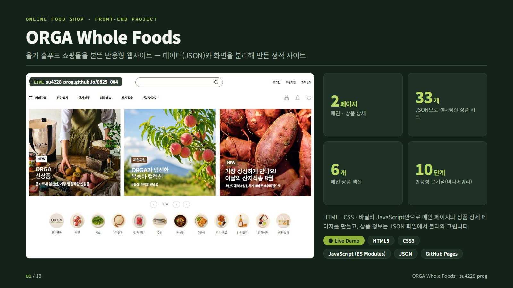<br /><sub>01 · 표지</sub><br /><br />
  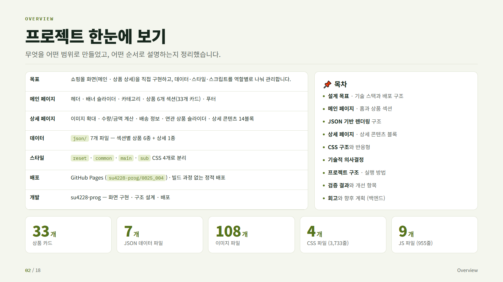<br /><sub>02 · 프로젝트 한눈에 보기</sub><br /><br />
  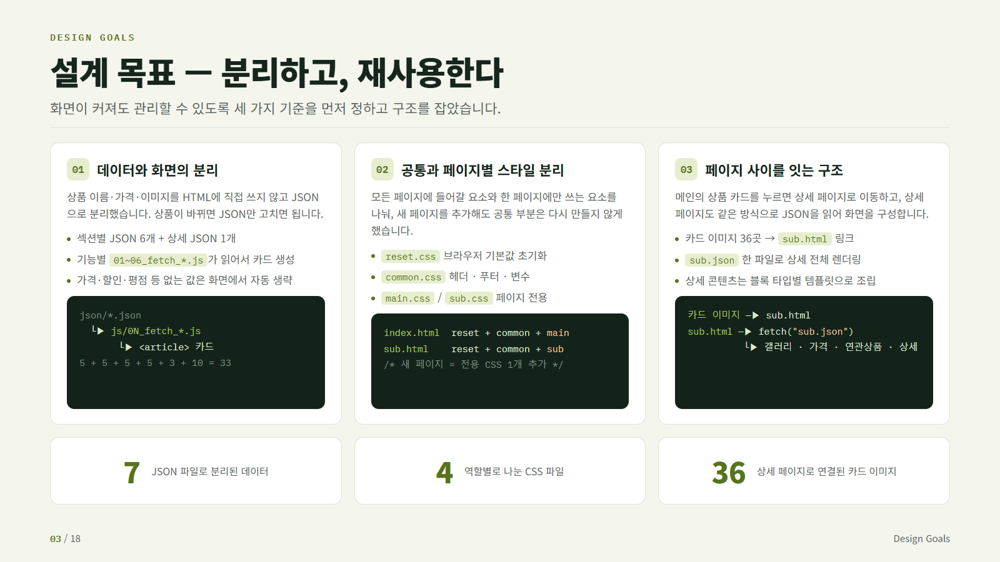<br /><sub>03 · 설계 목표</sub><br /><br />
  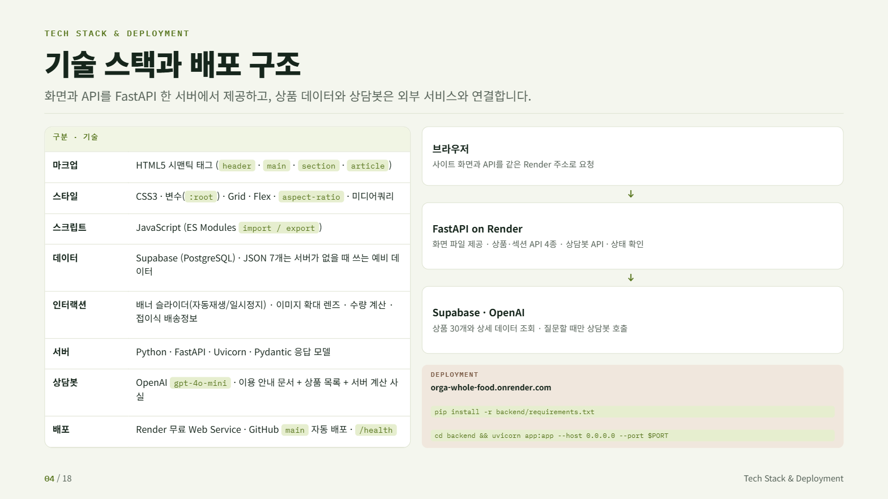<br /><sub>04 · 기술 스택과 배포 구조</sub><br /><br />
  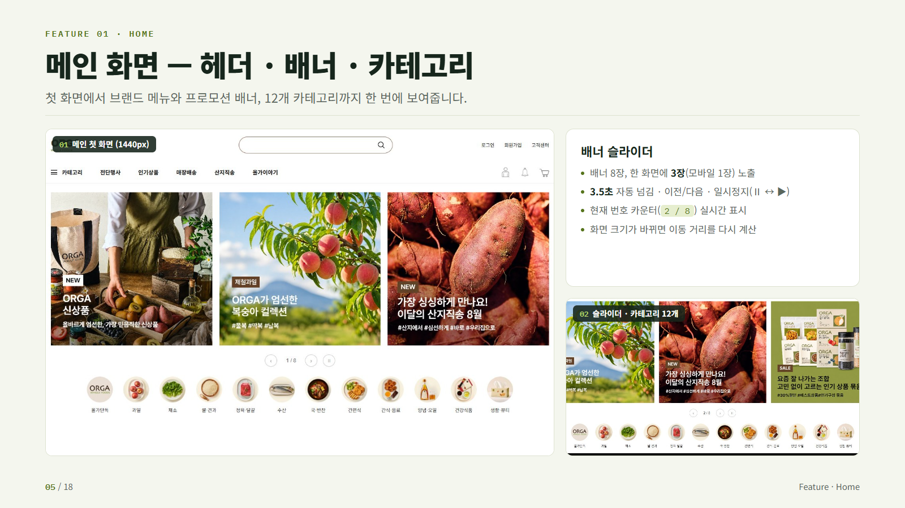<br /><sub>05 · 메인 화면 — 헤더 · 배너 · 카테고리</sub><br /><br />
  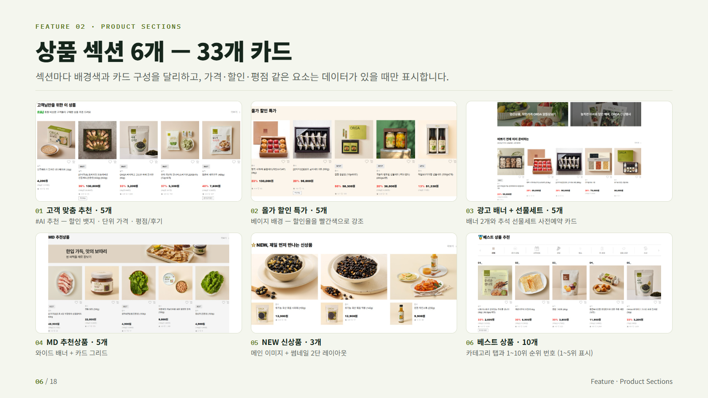<br /><sub>06 · 상품 섹션 6개 — 33개 카드</sub><br /><br />
  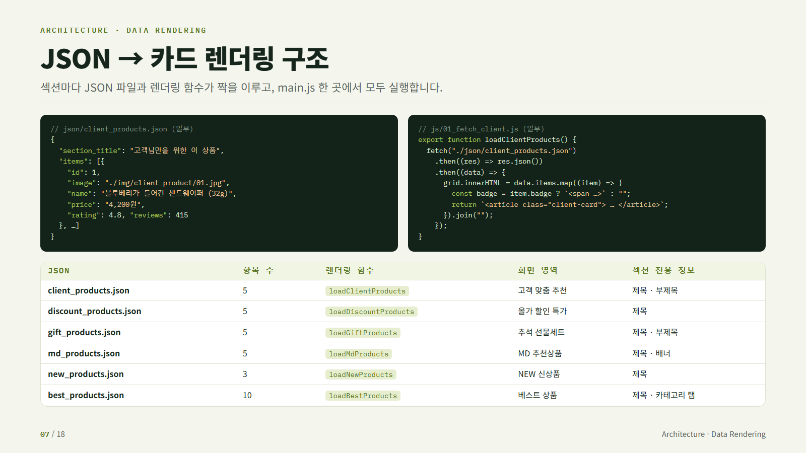<br /><sub>07 · JSON → 카드 렌더링 구조</sub><br /><br />
  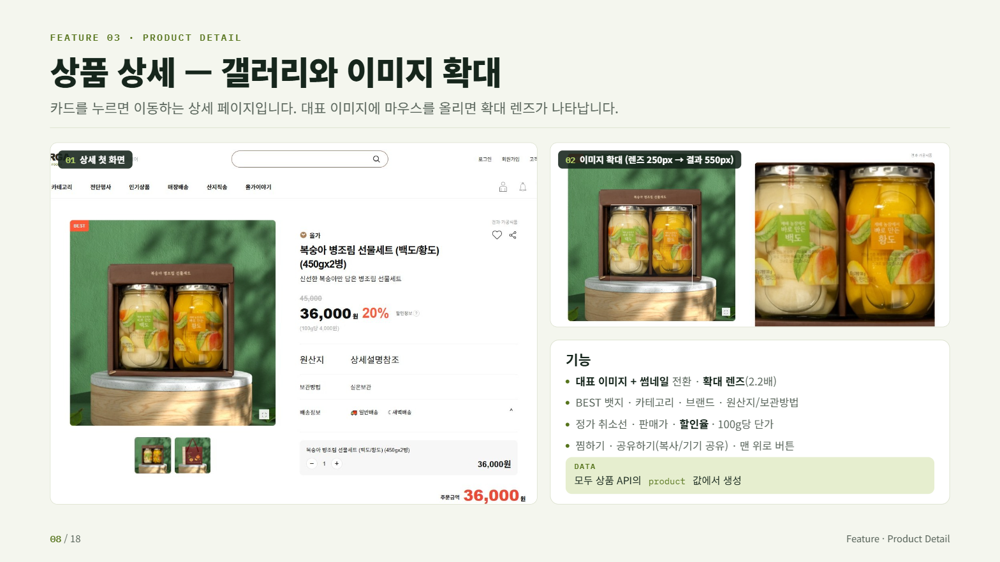<br /><sub>08 · 상품 상세 — 갤러리와 이미지 확대</sub><br /><br />
  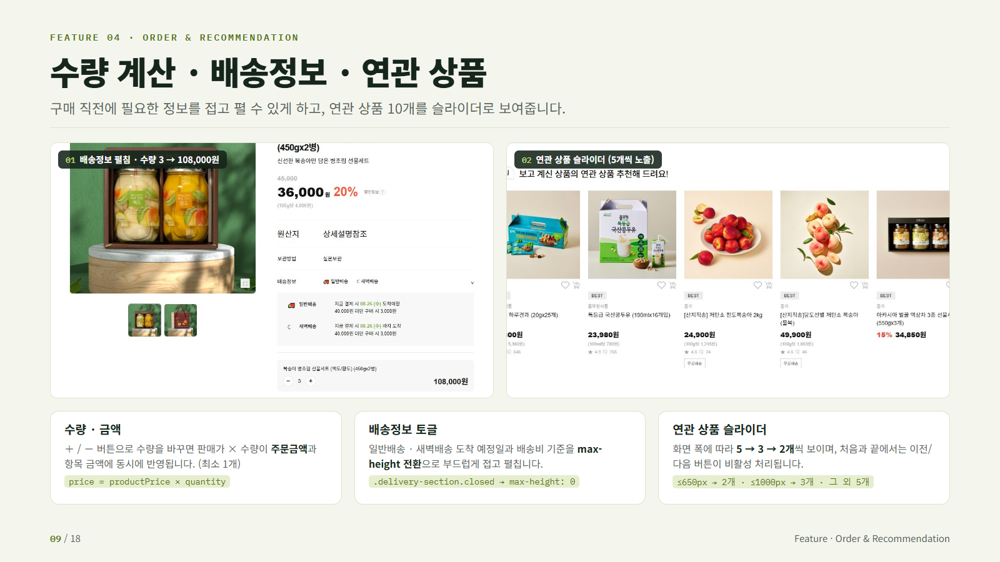<br /><sub>09 · 수량 계산 · 배송정보 · 연관 상품</sub><br /><br />
  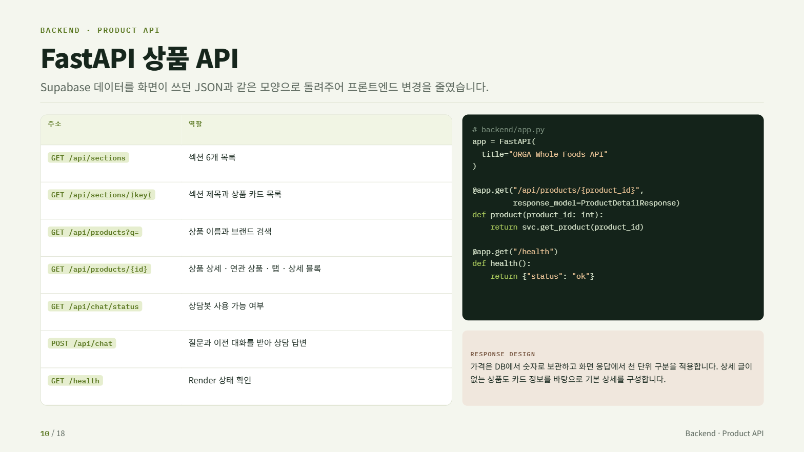<br /><sub>10 · 상세 설명은 “블록” 14개로 조립</sub><br /><br />
  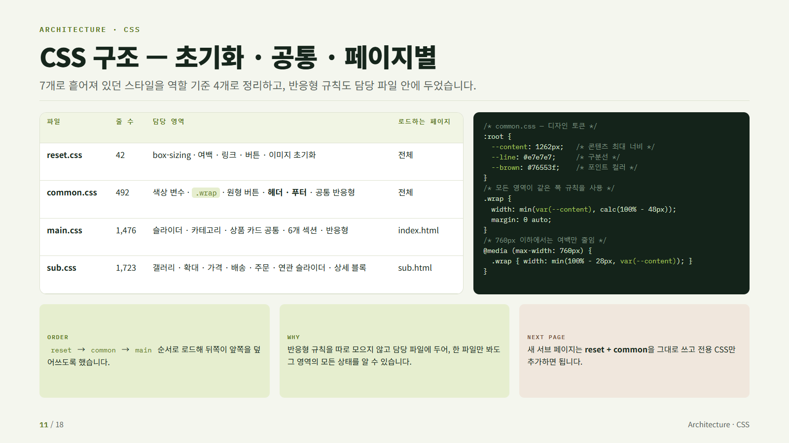<br /><sub>11 · CSS 구조 — 초기화 · 공통 · 페이지별</sub><br /><br />
  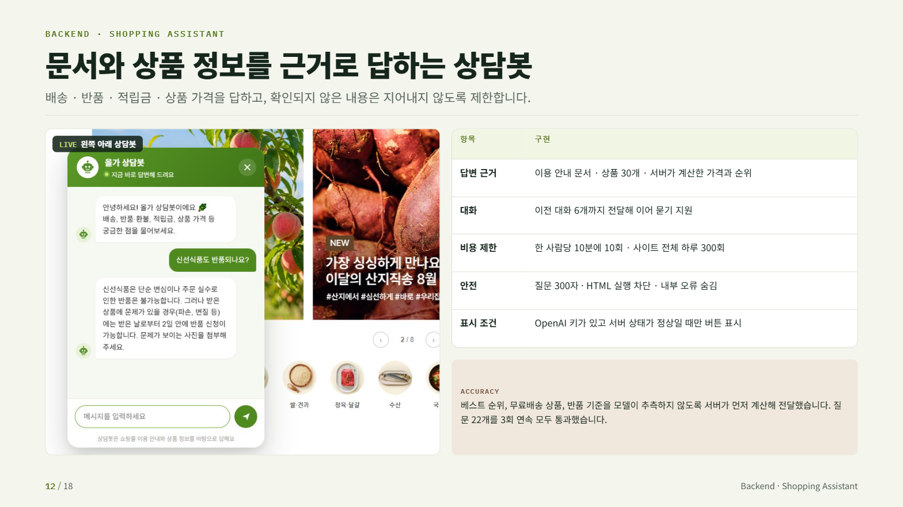<br /><sub>12 · 반응형 — 데스크톱에서 모바일까지</sub><br /><br />
  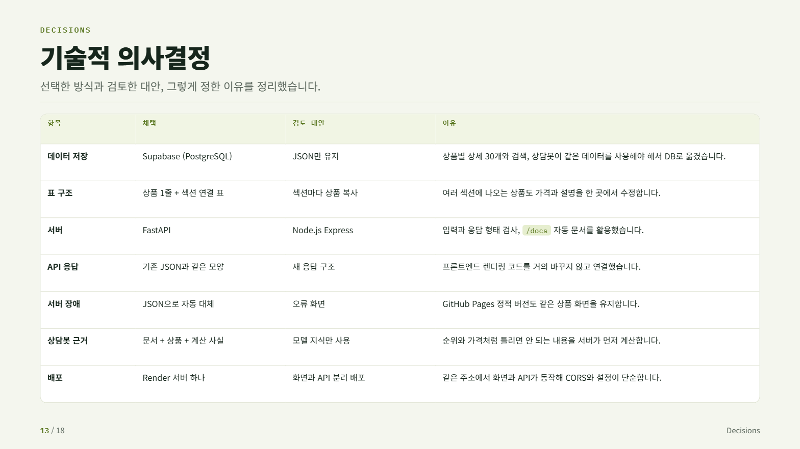<br /><sub>13 · 기술적 의사결정</sub><br /><br />
  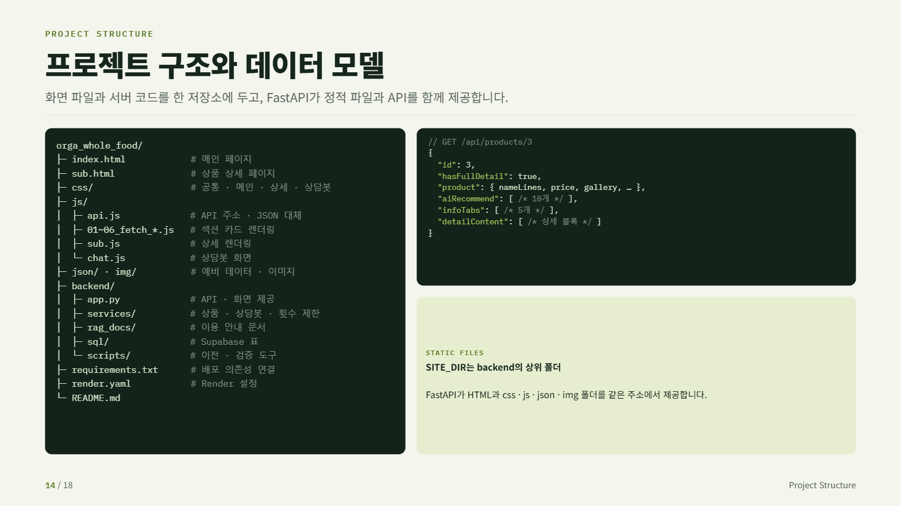<br /><sub>14 · 프로젝트 구조와 데이터 모델</sub><br /><br />
  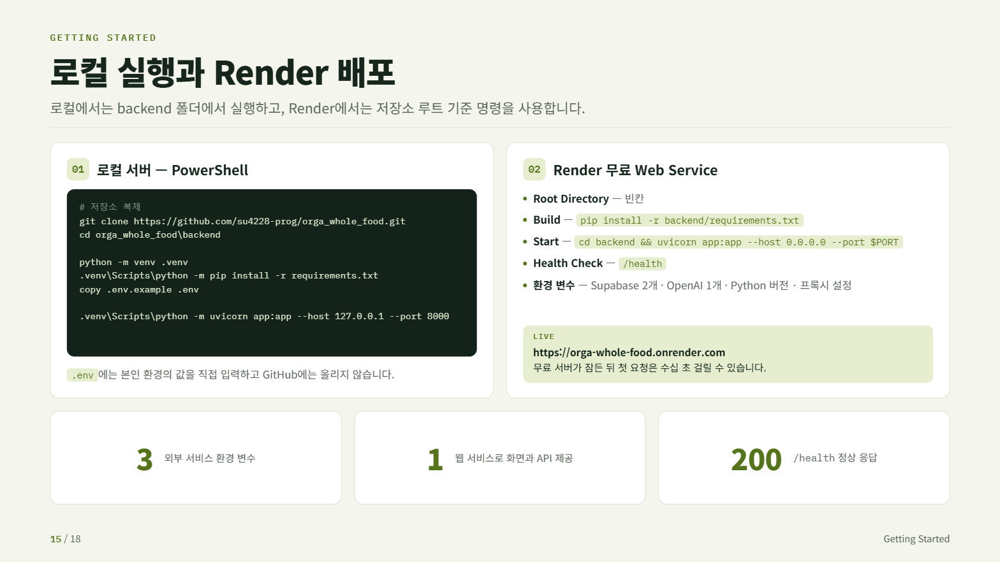<br /><sub>15 · 실행 방법</sub><br /><br />
  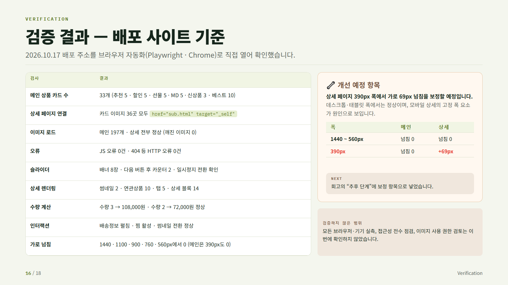<br /><sub>16 · 검증 결과 — 배포 사이트 기준</sub><br /><br />
  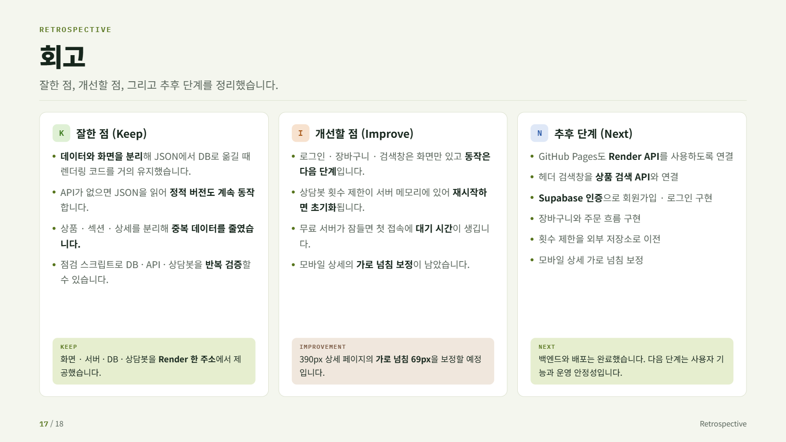<br /><sub>17 · 회고</sub><br /><br />
  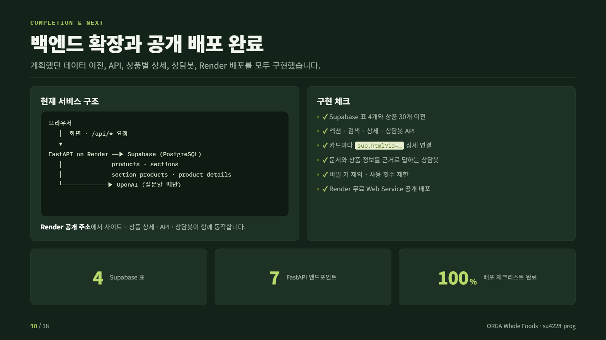<br /><sub>18 · 1차 당시 계획 — 백엔드로 확장 (현재 완료)</sub><br /><br />
</p>

</details>

---

<sub>ORGA Whole Foods · su4228-prog · 검증 기준일 2026.10.20</sub>
